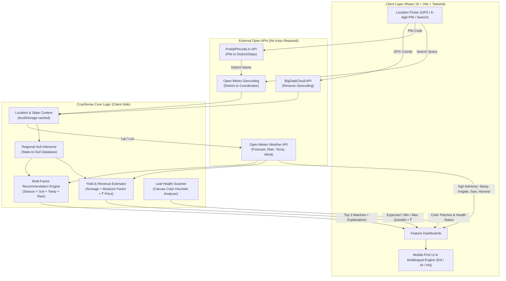

# 🌱 CropSense — Sense. Decide. Grow.

[](https://react.dev/)
[](https://www.typescriptlang.org/)
[](https://vitejs.dev/)
[](https://tailwindcss.com/)
[](LICENSE)
[](https://github.com/youknowme19/cropsense/pulls)

> **Smarter farming. Simpler decisions.**  
> CropSense is a lightweight, mobile-first agricultural advisory platform designed specifically for Indian farmers. It turns open agrometeorological and regional soil data into actionable farming advice, season-aligned crop recommendations, harvest yield forecasts, and quick plant-health checks — accessible in English, Hindi, and Kannada.

---

## 📑 Table of Contents

- [Overview](#-overview)
- [System Architecture & Data Flow](#-system-architecture--data-flow)
- [Core Features](#-core-features)
- [Recommendation & Yield Logic](#-recommendation--yield-logic)
- [Tech Stack & Data Sources](#-tech-stack--data-sources)
- [Project Structure](#-project-structure)
- [Getting Started](#-getting-started)
- [Roadmap](#-roadmap)
- [Contributing](#-contributing)
- [License](#-license)

---

## 🌾 Overview

Smallholder and regional farmers frequently make critical decisions—such as sowing dates, crop selection, chemical spraying, and irrigation schedules—without access to localized agro-climatic intelligence. CropSense bridges this gap by combining:

1. **Hyperlocal location resolution** (GPS geolocation, 6-digit Indian Postal PIN codes, and city/district search).
2. **Key-free open agrometeorology** (live temperatures, humidity, wind speeds, 5-day precipitation forecasts, and 30-day cumulative rainfall).
3. **Regional soil inference & multi-variable scoring** (temperature envelopes, rainfall requirements, and crop suitability across Indian cropping seasons).
4. **Native multilingual support** (English, हिन्दी, and ಕನ್ನಡ) with high-contrast, touch-friendly UI design.

---

## 📊 System Architecture & Data Flow



---

## ✨ Core Features

### 1. 📍 Smart Location Resolution
- **GPS Auto-Locate**: Resolves current device latitude and longitude via high-precision geolocation and reverse geocodes locality and state.
- **PIN Code Lookup**: Enter any 6-digit Indian PIN code to immediately map to postal district and state via the Postal Pincode API.
- **Direct Search**: Autocomplete place search across India backed by Open-Meteo geocoding.
- **Persistent State**: Retains user location across visits via `localStorage`.

### 2. ⛅ Hyperlocal Agrometeorology & Farming Advisories
- Real-time temperature (°C), relative humidity (%), and wind speed (km/h).
- 5-day forecast displaying diurnal high/low temps, precipitation probability (%), and rainfall depth (mm).
- **Automated Farm Actions**:
  - **💧 Irrigation**: Detects expected 48-hour rainfall; advises skipping watering if rain > 5 mm is imminent.
  - **💨 Spraying**: Warns against spraying when rain probability exceeds 50% or wind speeds exceed 20 km/h to prevent pesticide drift and runoff.
  - **🌱 Sowing**: Flags caution when severe downpours (> 70% probability) could wash away newly sown seeds.
  - **🌾 Harvesting**: Highlights optimal dry windows or warns to harvest early / cover yields when rain threatens.

### 3. 🌾 Multi-Factor Crop Recommendation Engine
- Automatically infers predominant regional soil types (Alluvial, Black, Red, Laterite, Sandy, Mountain) with one-click manual overrides.
- Detects the current Indian agricultural season (**Kharif**, **Rabi**, or **Zaid**) using real-time calendar tracking.
- Scores 15 major Indian crops (Rice, Wheat, Maize, Cotton, Sugarcane, Groundnut, Soybean, Ragi, Jowar, Tur, Gram, Mustard, Potato, Tomato, Onion) on compatibility curves.
- Ranks the **Top 3 crops** with transparent, plain-language suitability reasons.

### 4. 📈 Harvest Yield & Revenue Estimator
- Dynamically calculates projected yields based on base productivity per acre, regional soil compatibility, and 30-day cumulative moisture factor.
- Toggle between **acres** and **hectares** with intuitive incremental controls.
- Displays realistic three-tier harvest bands (**Low**, **Expected**, and **High** yields in quintals and kilograms).
- Optional market price calculator: input expected mandi rate (₹ per quintal) to calculate estimated farm revenue.

### 5. 🍃 Leaf Disease Screening (Local Vision Heuristic)
- Upload photo from camera or gallery.
- Performs on-device image processing using HTML5 Canvas pixel-data heuristics to identify discoloration, yellowing, and necrotic spotting.
- Offers actionable immediate advice (e.g., removing damaged leaves, sanitation, consulting extension officers).
- *Explicitly flagged as a local first-check heuristic, directing farmers to agricultural officers for definitive chemical or biological diagnoses.*

### 6. 🌐 Multilingual & Accessible
- Seamless language toggle between **English**, **हिन्दी (Hindi)**, and **ಕನ್ನಡ (Kannada)**.
- High-contrast, countryside-inspired color palette (`#2E7D32` Leaf Green, `#F2B84B` Wheat Gold, `#4A2E18` Soil Brown, and Soft Sky Blue).
- Minimum 48px touch targets for effortless field use on smartphones.
- Respects `prefers-reduced-motion` settings.

---

## 🧮 Recommendation & Yield Logic

### 1. Crop Scoring Formula

Each crop $C$ is scored out of 100 points based on 4 weighted criteria:

$$\text{Score} = W_{\text{season}} + W_{\text{soil}} + \text{Fit}(T_{\text{curr}}, T_{\text{crop}}, 25) + \text{Fit}(R_{30\text{d}}, R_{\text{crop}}, 20)$$

Where:
- **Season Fit ($W_{\text{season}}$)**: $30\text{ pts}$ if active season is supported; else $5\text{ pts}$.
- **Soil Fit ($W_{\text{soil}}$)**: $25\text{ pts}$ if region soil is an ideal match; else $8\text{ pts}$.
- **Temperature Fit ($\text{Fit}_T$)**: Up to $25\text{ pts}$ when within optimal range $[T_{\min}, T_{\max}]$; smoothly degrades based on distance from optimum.
- **Rainfall Fit ($\text{Fit}_R$)**: Up to $20\text{ pts}$ when 30-day cumulative rain matches monthly requirement range $[R_{\min}, R_{\max}]$.

### 2. Yield Prediction Formula

$$\text{Yield} = Y_{\text{base}} \times \text{Area} \times S_{\text{soil}} \times F_{\text{rain}}$$

- $Y_{\text{base}}$: Average yield (quintals/acre).
- $S_{\text{soil}}$: Soil compatibility coefficient ($1.0$ if primary soil; $0.6$ if marginal).
- $F_{\text{rain}}$: Rainfall factor ($1.0$ if optimal; $0.88$ for moderate deviation; $0.70$ for severe deficit or excess).
- Harvest output displays with confidence bounds at $\pm 20\%$ to account for microclimate variance.

---

## 🛠 Tech Stack & Data Sources

| Layer | Technology / Source | Description |
|---|---|---|
| **Frontend Framework** | React 18 + TypeScript | Component architecture with strict type safety |
| **Build Tool** | Vite 5.4 | Fast HMR and lightweight bundle production |
| **Styling** | Tailwind CSS 3.4 | Utility-first styling with custom agricultural palette |
| **Icons** | Lucide React | Lightweight, accessible iconography |
| **Routing** | React Router DOM v6 | Single-page client-side route navigation |
| **Weather API** | [Open-Meteo](https://open-meteo.com/) | Live weather & 5-day forecast (Free, No API key) |
| **Geocoding API** | Open-Meteo Geocoding | District and city coordinate search (No API key) |
| **Reverse Geocoding** | [BigDataCloud API](https://www.bigdatacloud.com/) | Reverse client GPS coordinates to city/state |
| **Postal Directory** | [PostalPincode.in](https://postalpincode.in/) | PIN code resolution for Indian post offices & districts |

---

## 📁 Project Structure

```text
cropsense/
├── index.html               # Entry HTML shell
├── package.json             # NPM package scripts & dependencies
├── postcss.config.js        # PostCSS configuration for Tailwind
├── tailwind.config.js       # Custom colors (leaf, wheat, paddy, soil, etc.)
├── tsconfig.json            # TypeScript configuration
├── vite.config.ts           # Vite bundler config
└── src/
    ├── App.tsx              # Root component, routes, language & location state
    ├── components.tsx       # Navbar, Footer, LocationPicker, Splash, Shells
    ├── index.css            # Tailwind directives, animations & custom styles
    ├── main.tsx             # DOM mount point
    ├── pages.tsx            # Home, About, Weather, CropPage, Yield, Disease views
    ├── translations.ts      # Dictionary & context for English, Hindi, Kannada
    ├── data/
    │   ├── crops.ts         # 15 crop profiles (seasons, temp, rain, soils, yields)
    │   └── soilByRegion.ts  # Indian states to dominant soil type mapping
    └── lib/
        ├── api.ts           # Geocoding, reverse geocoding, and Open-Meteo client
        └── recommendCrop.ts # Season calculation & crop recommendation algorithms
```

---

## 🚀 Getting Started

### Prerequisites
- [Node.js](https://nodejs.org/) (version 18.x or later)
- `npm` or `pnpm` / `yarn`

### Installation

1. **Clone the repository:**
   ```bash
   git clone https://github.com/youknowme19/cropsense.git
   cd cropsense
   ```

2. **Install dependencies:**
   ```bash
   npm install
   ```

3. **Start the development server:**
   ```bash
   npm run dev
   ```
   Open `http://localhost:5173` in your browser.

4. **Build for production:**
   ```bash
   npm run build
   ```
   The production-ready output will be generated in the `dist/` directory.

---

## 🗺 Roadmap

- [ ] **AI-Powered Disease Vision Endpoint**: Connect `analyse()` to a serverless vision model (e.g. Gemini 1.5 Flash or a fine-tuned MobileNet/ResNet model trained on PlantVillage) for deep leaf diagnosis.
- [ ] **Real-time APMC Mandi Prices**: Integrate Agmarknet / e-NAM API for live market pricing across nearby mandis.
- [ ] **Offline PWA Support**: Add service workers and offline caching for field use with intermittent connectivity.
- [ ] **Additional Regional Languages**: Expand translations to Telugu (తెలుగు), Tamil (தமிழ்), Marathi (मराठी), and Punjabi (ਪੰਜਾਬੀ).
- [ ] **Soil Testing Lab Directory**: Connect farmers to nearby government Krishi Vigyan Kendras (KVK) and soil-testing centers.

---

## 🤝 Contributing

Contributions make the open-source community a better place to learn, inspire, and create. Any contributions you make are **greatly appreciated**.

1. Fork the Project
2. Create your Feature Branch (`git checkout -b feature/AmazingFeature`)
3. Commit your Changes (`git commit -m 'Add some AmazingFeature'`)
4. Push to the Branch (`git push origin feature/AmazingFeature`)
5. Open a Pull Request

---

## 📜 License

Distributed under the MIT License. See `LICENSE` for more information.

---

<p align="center">
  Built with ❤️ for Indian Agriculture and Farming Communities.
</p>
